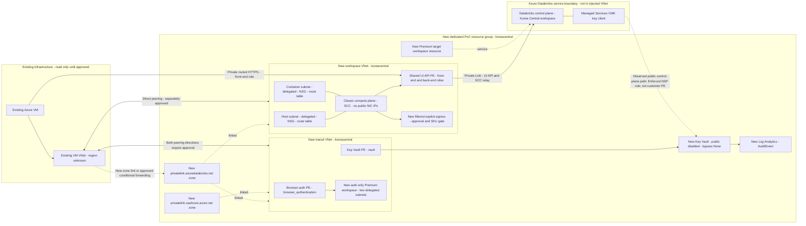

# Proposed architecture and network flows

> **Current as-built CMK note — 2026-10-19:** CMK-IP-03 succeeded at 01:18:23–01:21:01 UTC with NSP absent and vault Enabled / Deny / None / one control-plane IP / zero VNet rules; a fresh version was applied and tags preserved. CMK-NSP-TAG-01 then succeeded: new isolated Korea Central NSP, native `Inbound` `serviceTags=['AzureDatabricks']` rule (provisioning Succeeded, zero address prefixes), vault association Enforced, LAW Learning/Transition; CMK start 01:29:16.8501Z, script finish 01:31:27.6947Z. Current workspace is `Succeeded`, PNA Disabled, newest version applied; vault Disabled / None / Deny / zero IP and VNet rules, owner policy-exclusion tag retained. Leave this posture unchanged.
>
> **Historical CMK-IP-02 result (superseded):** NSP removed and absence verified; vault public Disabled / bypass `None` / Deny with one stored firewall IP rule. New-version CMK retry failed with `ForbiddenByConnection`; workspace provisioning was `Failed`, previous key version retained. The rule was not an active public-access exception. Later recovery and both successful tests above supersede this snapshot.

**Deployed architecture differs from this original proposal.** See the [deployment guide](deployment-guide.md) and [inventory](resource-inventory.md). Differences: NAT gateway instead of a firewall; no route tables or resolver; VM peerings were later approved and created; the vault endpoint is in the workspace VNet, plus a second vault endpoint in the existing VM's subnet with a VM-only DNS zone. The diagram below remains the proposal, not an as-built diagram. Current validation: F1/F2 reachability only (no authenticated API/browser login), F4 verified from the VM, F5 successful public control-plane key access under the native NSP tag configuration after the selected-IP success. F5 is **not** a customer-private-endpoint path. F3 and F8 remain untested.

**The diagram below is the original proposed topology, not the deployed topology.** Its regional-resource intent was Korea Central; actual placement and deviations are recorded in the [inventory](resource-inventory.md). The existing VM's location was left unchanged. Private DNS zones use Azure's global location.

## Why two new VNets?

The reviewed Private Link guidance separates transit/authentication from classic compute. The existing VM VNet is a client network only, not reused to host PoC endpoints. Two new VNets stay within one new customer RG. The **proposed simplification uses one shared `databricks_ui_api` endpoint for front-end and back-end roles**, which the concepts documentation identifies as functions of this endpoint type. It is placed in the workspace VNet and reached directly by the VM. Browser auth and vault endpoints are in the new transit VNet. This is a disposable-lab topology, not the separate-front-end-endpoint production reference topology. Confirm the exact combination during regional/support review before approval.

Peering is not transitive. Create **two direct peering pairs**: VM VNet↔workspace VNet and VM VNet↔transit VNet. Each pair includes a child resource under the existing VNet, so each requires approval. NSGs on new compute subnets must limit unnecessary VM-to-cluster traffic; peering is broader than PE-only reachability. No gateway transit or forwarded traffic is enabled by default. No transit↔workspace peering is proposed unless a verified dependency requires it.

## DNS design

- Create **one new** `privatelink.azuredatabricks.net` zone, linked to both new VNets and, after approval/conflict review, the VM VNet. The shared UI/API endpoint supplies workspace/relay records; the auth endpoint supplies auth records. Preserve all required records from PE DNS metadata, not just the workspace A record.
- There is **one UI/API PE** (workspace/relay records) and **one separate browser-auth PE** (auth records), plus the unrelated vault PE in its own zone. “Shared” means two traffic roles on the UI/API endpoint, not a merge of UI/API and browser-auth subresources. Avoiding a second UI/API endpoint prevents competing zone groups for the same workspace records. Never create two independent same-name zones in the same RG (Azure resource identity forbids it), or publish unreachable endpoint addresses to round-robin DNS. If independent front/back-end endpoints or DNS views become mandatory, revise the plan and obtain approval for the additional resource-placement/connectivity design first.
- No existing zone may be reused, altered or replaced. A new-zone link can still change DNS for other existing workspaces in the VM VNet; inspect and approve this impact first.
- Create one new `privatelink.vaultcore.azure.net` zone in the PoC RG. Link to new transit VNet; add VM VNet link only after approval. Workspace VNet link is optional for a separately scoped compute-to-vault control test, not a solution for CMK.
- Private-zone links live under the new zone in the PoC RG but linking an existing VNet affects resolution and requires approval and VNet join permissions. A VNet already linked to another same-name zone cannot simply be linked again.
- Custom DNS does not automatically consult the zone just because peering exists. If the VM uses custom DNS, propose a **new Korea Central Private DNS Resolver** with a dedicated inbound subnet in the PoC RG, then request approval for the exact existing DNS conditional forwarders. Do not change the VM adapter/VNet DNS or hosts file as a shortcut.
- Read the actual workspace, SCC relay and auth FQDNs from approved PE DNS metadata. Do not guess the regional `pl-auth` record format. Keep public hostnames for TLS SNI and certificate verification.

## Flow register

| ID | Source → destination | Purpose | Connectivity and DNS | Controls | State |
| --- | --- | --- | --- | --- | --- |
| F1 | VM → shared UI/API PE → control plane | Front-end browser/API access | Direct private peering to workspace VNet; workspace FQDN → approved PE IP | Workspace public disabled; authenticated API not yet tested | Reachability verified (private DNS, TCP/TLS, HTTPS 303); auth untested |
| F2 | VM → browser-auth PE | Private SSO callback | Private transit route; PE-derived regional auth DNS | Auth workspace public disabled; browser flow not yet tested | Reachability verified (private DNS, TCP/TLS, HTTPS 303); browser login untested |
| F3 | Classic compute → shared UI/API PE → control plane | Back-end API and SCC relay | Workspace VNet; workspace/relay private DNS | SCC, no public NIC IPs, `NoAzureDatabricksRules`, required ports | Not run; no cluster started |
| F4 | VM → vault PE → Key Vault | Create/administer disposable RSA key | VM VNet; vault FQDN → VM-side vault PE | Vault PNA Disabled, bypass None, RBAC | Verified: private DNS and key creation; proves only VM path |
| F5 | Managed Services key client → Key Vault | Get/Unwrap for control-plane data | Public source; current Enforced NSP has a native AzureDatabricks service-tag rule, zero address prefixes. No customer PE route established | Vault PNA Disabled / None / Deny / zero IP and VNet rules; RBAC remains required | CMK-NSP-TAG-01 new-version success; audit includes Unwrap 200 at 01:30:18 UTC, RBAC true, TrustedService AzureDatabricks. No tag-removal control; vendor support unconfirmed |
| F6 | Key Vault → Azure Monitor | Audit delivery | Azure diagnostic pipeline, not F4/F5 client routing | New diagnostic setting, new LAW, controlled retention | Planned; not proof of private CMK |
| F7 | Classic compute → platform dependencies | Storage, identity/bootstrap, packages | Dependency-specific; explicit filtered outbound design required | New egress infrastructure/rules; no inbound service exposure | Blocked until allowlist/SKU review |
| F8 | External public client → workspace/vault | Negative network control | Genuine public egress; public DNS preserves hostname/SNI | Network denial with authorized identity; no firewall weakening | Not run |

An NCC vault private endpoint rule and Approved foreign vault connection remain from the user-requested test; NCC alone with bypass `None` failed earlier. Microsoft documents NCC for serverless compute, not for the control plane's Managed Services CMK requests. It remains a confounder in both latest tests. The historical CMK-NSP-03 A/B tested an explicit address rule, not the current native service-tag rule; its negative control cannot be transferred to the tag test. CMK-IP-03 audit had three Get and one Unwrap, all 200 with RBAC and address authorization true, from the allowed public IP. For the tag run only the evidenced Unwrap success is asserted; Get counts and address authorization are not inferred.

The native tag represents the cloud-wide Azure Databricks service range, not one workspace, tenant or Korea Central-only boundary. RBAC is still required; a global tag does not guarantee a supported regional or custom tag. See [scope, publication-feed caveats and the Preview/reference conflict](feasibility.md#native-nsp-service-tag-scope-and-documentation-conflict). No tag-removal negative control, external public-denial test or vendor confirmation was obtained. Azure Resource Manager/Entra authorization traffic and possible controlled dependency egress are distinct from service data-plane ingress. This architecture is not a claim that all Azure communications avoid public endpoints.
